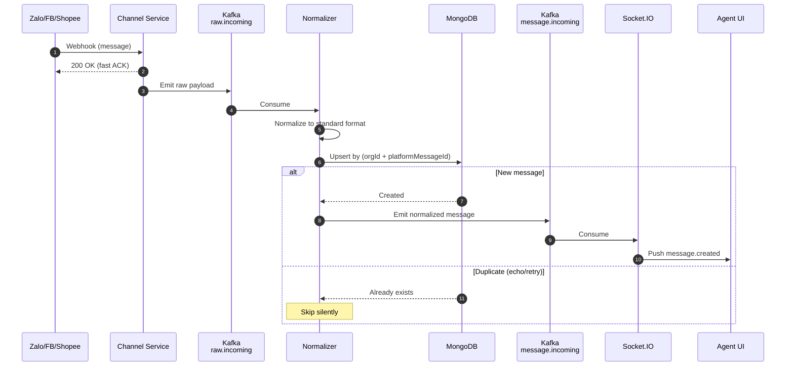
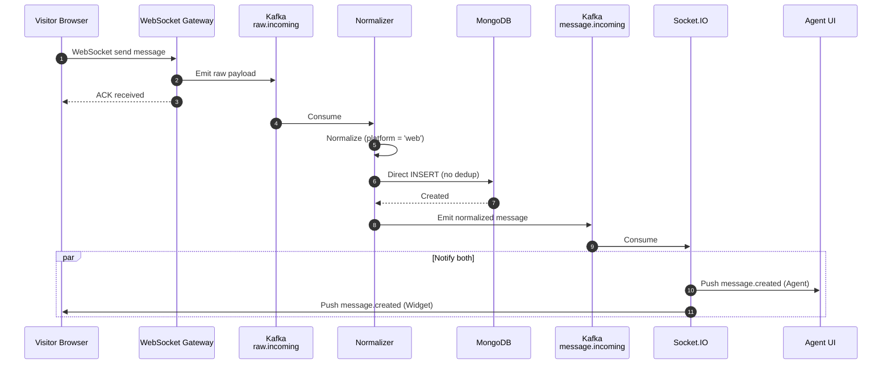
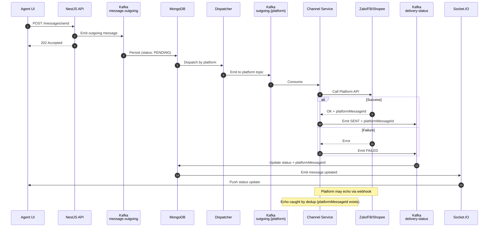
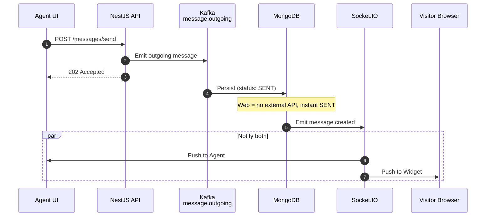
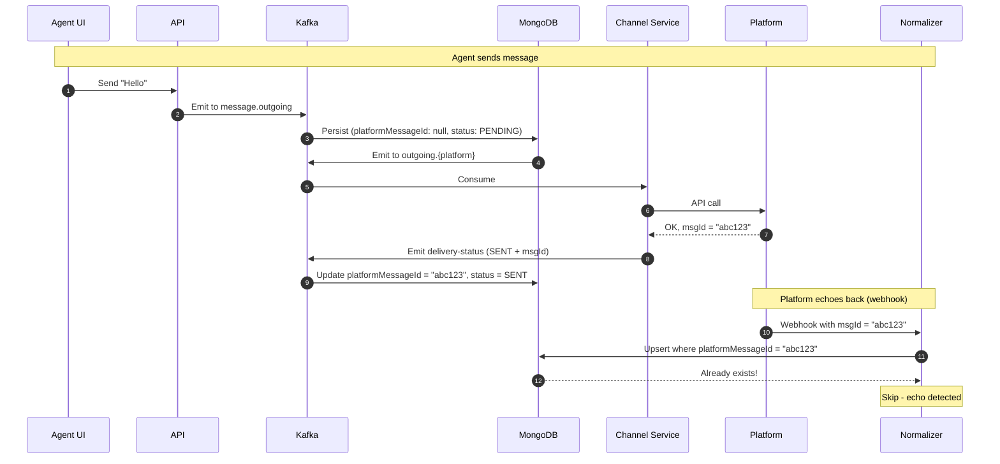
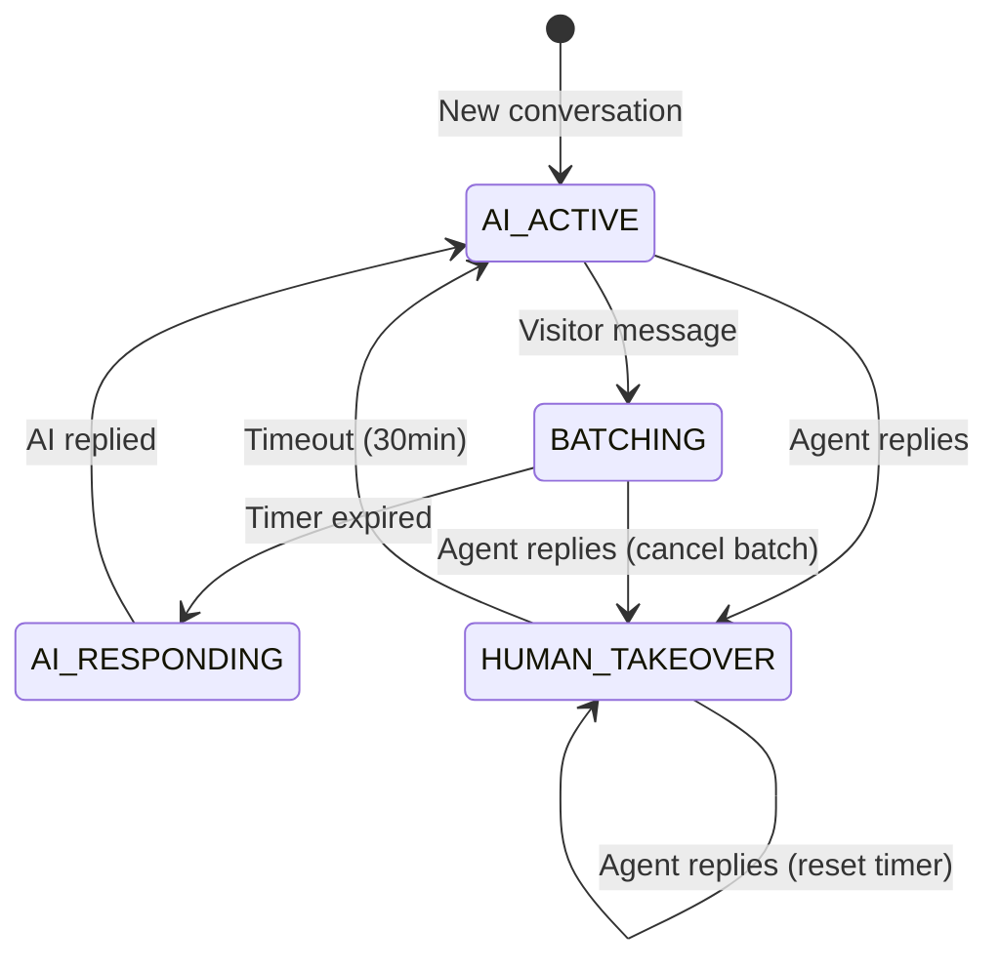
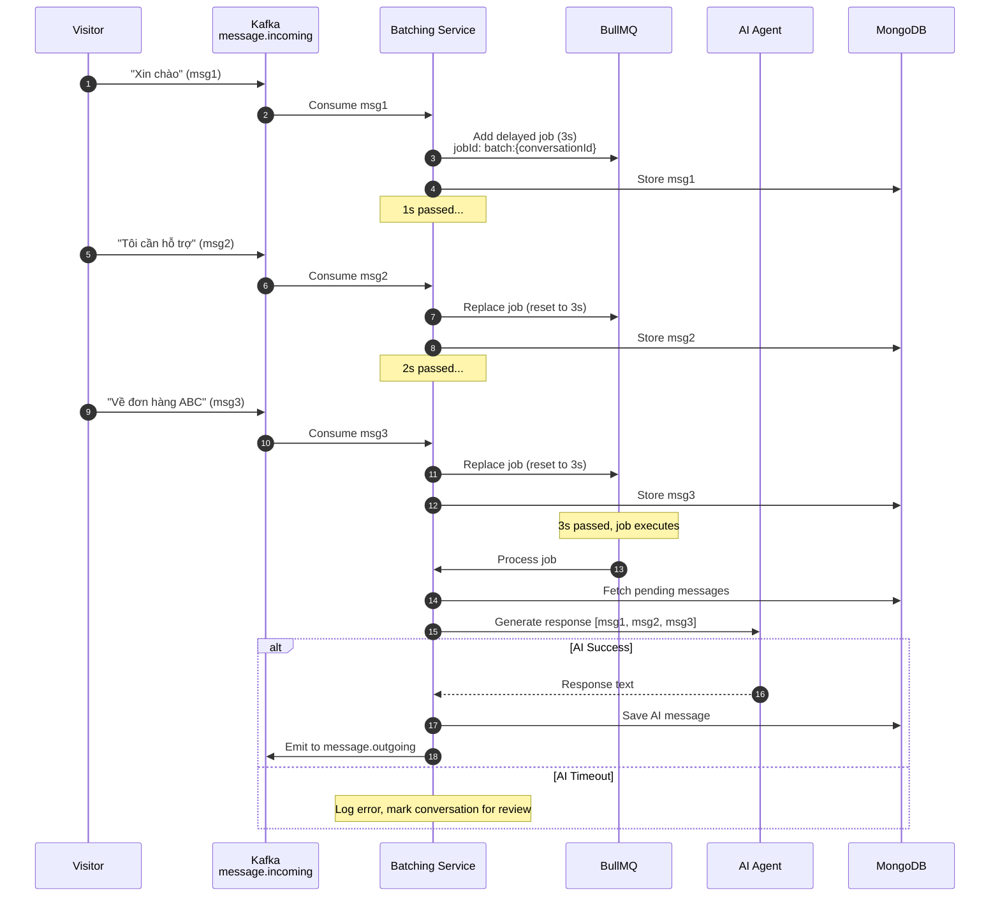
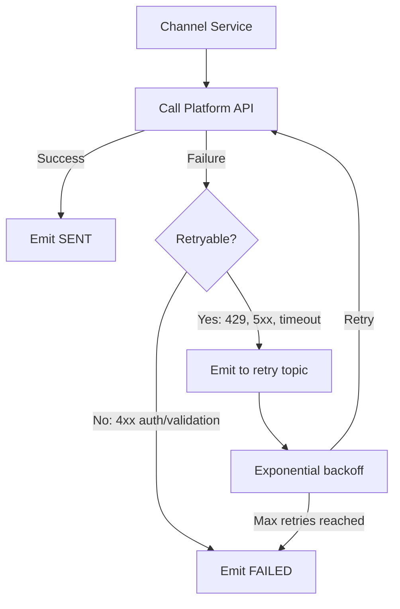

# Message Flow Architecture

Omnichannel chat platform message flow with deduplication and AI message batching.

**Last Updated**: 2025-12-22 - Deduplication implementation verified and documented

---

## Table of Contents

1. [Product Decisions](#product-decisions)
2. [Architectural Rules](#architectural-rules)
3. [Incoming Message Flow](#incoming-message-flow)
4. [Outgoing Message Flow](#outgoing-message-flow)
5. [Deduplication Strategy](#deduplication-strategy)
6. [AI Message Batching](#ai-message-batching)
7. [Kafka vs Socket.IO](#kafka-vs-socketio)
8. [Outgoing Retry Logic](#outgoing-retry-logic)
9. [MongoDB Indexes](#mongodb-indexes)

---

## Product Decisions

| Decision | Description |
|----------|-------------|
| Shared inbox | All org members see all conversations |
| No agent assignment | Any member can reply to any conversation |
| Message-centric | Append-only, no edit/delete |
| No presence events | No typing/joined indicators |

---

## Architectural Rules

| Rule | Rationale |
|------|-----------|
| Channel Services = thin I/O only | Business logic centralized |
| Kafka = source of truth | Durable, replayable event stream |
| Persist before external calls | No data loss on failures |
| Incoming = idempotent | Handle webhook retries + echoes |
| Outgoing = retry + status tracking | Reliable delivery |
| Socket.IO = notifications only | System works if Socket.IO down |

---

## Incoming Message Flow

### Platform Channels (Zalo/FB/Shopee)



**Steps:**
1. Platform sends webhook
2. Channel Service returns 200 OK immediately (fast ACK prevents retries)
3. Raw payload emitted to Kafka
4. Normalizer transforms platform-specific → standard format
5. Upsert to MongoDB by `platformMessageId`
6. If new: emit to `message.incoming` → Socket.IO notifies UI
7. If duplicate: skip silently

### Web Widget



**Key difference:** No dedup needed for web widget - messages always new.

---

## Outgoing Message Flow

### Agent → Platform



**Steps:**
1. Agent sends message via API
2. API returns 202 Accepted, emits to Kafka
3. Message persisted with `status: PENDING`
4. Dispatcher routes to platform-specific topic
5. Channel Service calls external API
6. Status update (SENT/FAILED) flows back via Kafka
7. UI receives status update via Socket.IO

### Agent → Web Widget



**Key difference:** No external API call, status = SENT immediately.

---

## Deduplication Strategy

### Echo Detection Flow



### Dedup Summary

| Flow | Dedup? | platformMessageId | Mechanism |
|------|--------|-------------------|-----------|
| Platform → Agent | ✅ | Required | Upsert by platformMessageId |
| Widget → Agent | ❌ | null | Direct insert |
| Agent → Platform | ✅ Echo caught | Set after API call | platformMessageId exists |
| Agent → Widget | ❌ | null | No external API |

### Implementation

**Atomic Upsert Pattern** (WebhookProcessorService)

```typescript
// Platform messages: Atomic upsert prevents duplicates and race conditions
private async saveMessageWithUpsert(
  normalized: NormalizedMessage,
  conversation: ConversationDocument,
  userProfile: UserProfile,
): Promise<MessageDocument | null> {
  const messageData = {
    conversationId: conversation._id,
    organizationId: conversation.organizationId,
    platform: conversation.platform,
    platformMessageId: normalized.platformMessageId,
    direction: normalized.direction,
    // ... other message fields
  };

  const result = await this.messageModel.findOneAndUpdate(
    {
      organizationId: conversation.organizationId,
      platform: conversation.platform,
      platformMessageId: normalized.platformMessageId,
    },
    { $setOnInsert: messageData },
    { upsert: true, new: true, includeResultMetadata: true },
  ).exec();

  // Return null if document already existed (duplicate)
  if (result.lastErrorObject?.updatedExisting) {
    return null;
  }

  return result.value;
}
```

**Key Design Points:**
- Query includes `platform` field for extra specificity (prevents cross-platform collisions)
- `$setOnInsert` only sets fields on document creation, ignores on update
- `includeResultMetadata: true` returns `lastErrorObject` with `updatedExisting` flag
- Returns `null` for duplicates to signal caller to skip further processing
- Atomic operation prevents race conditions on concurrent identical webhooks

**Web Widget Messages** (Direct Insert)

```typescript
// Web widgets: Direct insert - no dedup needed
async createFromWidget(data: WidgetMessage): Promise<Message> {
  return this.messageModel.create({
    ...data,
    platform: 'web',
    platformMessageId: null,  // Web messages never from external platform
  });
}
```

---

## AI Message Batching

Users may send multiple messages rapidly. AI agent should wait for all messages before responding.

### Conversation AI State



### When Batching Applies

| Condition | Batching? |
|-----------|-----------|
| Conversation state = AI_ACTIVE | ✅ Yes |
| Conversation state = HUMAN_TAKEOVER | ❌ No |
| AI disabled for organization | ❌ No |

### Configuration

```typescript
// organization settings
interface AISettings {
  batchDelayMs: number;       // Default: 3000 (3 seconds)
  enabled: boolean;           // AI auto-reply enabled
  humanTakeoverMinutes: number; // Default: 30 (human takeover window)
  maxBatchSize: number;       // Default: 10 (prevent memory issues)
  aiTimeoutMs: number;        // Default: 30000 (AI response timeout)
}
```

### Edge Cases

| Scenario | Behavior |
|----------|----------|
| Human agent replies while batch pending | Cancel batch, human takes over |
| Visitor sends more after AI responds | New batch starts |
| AI disabled mid-batch | Cancel batch, no response |

### Flow với Debounce (BullMQ)



### Implementation: BullMQ

**Why BullMQ:**
- Built-in job management (retry, monitoring)
- Cleaner than Redis keyspace notifications
- Already using Redis anyway
- Better debugging với Bull Board UI

### Human Takeover Logic

```typescript
// batching.service.ts
async onMessageReceived(message: Message): Promise<void> {
  // Skip batching if human recently replied
  const lastAgentMessage = await this.messageService.findLastAgentMessage(
    message.conversationId
  );

  if (lastAgentMessage) {
    const minutesSinceReply =
      (Date.now() - lastAgentMessage.createdAt.getTime()) / 60000;

    if (minutesSinceReply < this.settings.humanTakeoverMinutes) {
      // Human takeover - skip AI batching
      return;
    }
  }

  // Proceed with AI batching
  await this.queueBatch(message);
}

async onAgentReply(conversationId: string): Promise<void> {
  // Cancel pending AI batch when human replies
  const jobId = `batch:${conversationId}`;
  const job = await this.queue.getJob(jobId);
  if (job) {
    await job.remove();
  }
}
```

### Complete BullMQ Implementation

```typescript
// modules/ai-batching/ai-batching.module.ts
@Module({
  imports: [
    BullModule.registerQueue({
      name: 'ai-batching',
      defaultJobOptions: {
        removeOnComplete: true,
        removeOnFail: 100, // Keep last 100 failed for debugging
      },
    }),
  ],
  providers: [AIBatchingService, AIBatchingProcessor],
  exports: [AIBatchingService],
})
export class AIBatchingModule {}

// modules/ai-batching/ai-batching.processor.ts
@Processor('ai-batching')
export class AIBatchingProcessor {
  constructor(
    private messageService: MessageService,
    private aiService: AIService,
    private socketService: SocketService,
  ) {}

  @Process('process-batch')
  async handleBatch(job: Job<{ conversationId: string; organizationId: string }>) {
    const { conversationId, organizationId } = job.data;

    // Double-check human hasn't taken over
    const lastAgentMessage = await this.messageService.findLastAgentMessage(conversationId);
    if (lastAgentMessage && this.isRecentHumanReply(lastAgentMessage)) {
      return; // Human took over, skip AI
    }

    // Fetch pending messages
    const messages = await this.messageService.getPendingForAI(conversationId);
    if (messages.length === 0) return;

    // Process with AI
    const response = await this.aiService.generateResponse(
      conversationId,
      messages,
    );

    // Save AI response
    const aiMessage = await this.messageService.createFromAI({
      conversationId,
      organizationId,
      content: response,
      sender: 'ai',
    });

    // Emit to outgoing queue (will be sent to platform)
    await this.kafka.emit('message.outgoing', aiMessage);
  }

  private isRecentHumanReply(message: Message): boolean {
    const minutes = (Date.now() - message.createdAt.getTime()) / 60000;
    return minutes < 30; // humanTakeoverMinutes
  }
}

// modules/ai-batching/ai-batching.service.ts
@Injectable()
export class AIBatchingService {
  constructor(
    @InjectQueue('ai-batching') private queue: Queue,
    private settingsService: SettingsService,
  ) {}

  async onVisitorMessage(message: Message): Promise<void> {
    const settings = await this.settingsService.getAISettings(message.organizationId);

    if (!settings.enabled) return;

    const jobId = `batch:${message.conversationId}`;

    // Remove existing delayed job (reset timer)
    const existingJob = await this.queue.getJob(jobId);
    if (existingJob) {
      await existingJob.remove();
    }

    // Add new delayed job
    await this.queue.add(
      'process-batch',
      {
        conversationId: message.conversationId,
        organizationId: message.organizationId,
      },
      {
        delay: settings.batchDelayMs,
        jobId,
      }
    );
  }

  async cancelBatch(conversationId: string): Promise<void> {
    const jobId = `batch:${conversationId}`;
    const job = await this.queue.getJob(jobId);
    if (job) {
      await job.remove();
    }
  }
}
```

---

## Kafka vs Socket.IO

| Concern | Kafka | Socket.IO |
|---------|-------|-----------|
| **Purpose** | Event sourcing, message delivery | Realtime UI notifications |
| **Durability** | Persistent, replayable | Fire-and-forget |
| **If down** | System halts (critical) | UI updates delayed (non-critical) |
| **Data flow** | All messages pass through | Only notification events |
| **Consumers** | Backend services | Browser clients |

### Golden Rule

> **Kafka** = Source of truth for all message flow
> **Socket.IO** = Optional convenience layer for realtime UX

If Socket.IO dies: Messages still flow, UI users see stale data until refresh.
If Kafka dies: Critical failure, system cannot process messages.

---

## Outgoing Retry Logic

### Retry Strategy



### Retry Configuration

```typescript
interface RetryConfig {
  maxRetries: number;      // Default: 3
  initialDelayMs: number;  // Default: 1000
  maxDelayMs: number;      // Default: 30000
  backoffMultiplier: number; // Default: 2
}
```

### Retryable vs Non-Retryable

| Error Type | Retryable? | Example |
|------------|------------|---------|
| Rate limit (429) | ✅ | Platform quota exceeded |
| Server error (5xx) | ✅ | Platform temporarily down |
| Timeout | ✅ | Network issue |
| Auth error (401/403) | ❌ | Token expired, need re-auth |
| Validation error (400) | ❌ | Invalid payload |
| Not found (404) | ❌ | User blocked bot |

---

## MongoDB Indexes

```javascript
// messages collection
db.messages.createIndex(
  { organizationId: 1, platformMessageId: 1 },
  { unique: true, sparse: true }  // sparse: web messages have null platformMessageId
)

db.messages.createIndex(
  { conversationId: 1, createdAt: -1 }  // message list queries
)

db.messages.createIndex(
  { conversationId: 1, status: 1 }  // pending messages for AI batching
)

db.messages.createIndex(
  { platformConnectionId: 1, createdAt: -1 }  // messages by page/connection
)

db.messages.createIndex(
  { status: 1, createdAt: 1 },
  { partialFilterExpression: { status: 'PENDING' } }  // retry queue
)
```

---

## Test Scenarios

### Incoming Message Tests

| # | Scenario | Steps | Expected |
|---|----------|-------|----------|
| I1 | Happy path - Platform message | 1. Send webhook from Zalo<br/>2. Wait for processing | Message in DB, Socket.IO emits `message.created` |
| I2 | Webhook retry - Same message twice | 1. Send webhook<br/>2. Send same webhook again (same platformMessageId) | Only 1 message in DB, second skipped |
| I3 | Fast ACK | 1. Send webhook<br/>2. Measure response time | 200 OK returned < 100ms |
| I4 | Widget message | 1. Send via WebSocket<br/>2. Wait for processing | Message in DB, both agent + visitor receive Socket.IO |
| I5 | Platform down during processing | 1. Send webhook<br/>2. Kill Normalizer mid-process<br/>3. Restart Normalizer | Kafka replays, message eventually persisted |

### Outgoing Message Tests

| # | Scenario | Steps | Expected |
|---|----------|-------|----------|
| O1 | Happy path - Send to platform | 1. POST /messages/send<br/>2. Wait for delivery | Status: PENDING → SENT, platformMessageId set |
| O2 | Platform API fails (retryable) | 1. POST /messages/send<br/>2. Mock platform 500 error | Retry 3 times with backoff, then FAILED |
| O3 | Platform API fails (non-retryable) | 1. POST /messages/send<br/>2. Mock platform 400 error | Immediate FAILED, no retry |
| O4 | Send to widget | 1. POST /messages/send (platform=web)<br/>2. Wait | Status: SENT immediately, Socket.IO to both |
| O5 | Echo detection | 1. Send outgoing<br/>2. Wait for platform webhook echo | Echo skipped (platformMessageId exists) |

### Deduplication Tests

| # | Scenario | Steps | Expected |
|---|----------|-------|----------|
| D1 | Echo from outgoing | 1. Send outgoing, get platformMessageId<br/>2. Simulate webhook with same platformMessageId | Webhook ignored, no duplicate |
| D2 | Concurrent webhooks | 1. Send 10 identical webhooks simultaneously | Only 1 message created |
| D3 | Kafka consumer restart | 1. Send webhook<br/>2. Kill consumer before commit<br/>3. Restart consumer | Message not duplicated (upsert handles) |

### AI Batching Tests

| # | Scenario | Steps | Expected |
|---|----------|-------|----------|
| B1 | Single message batch | 1. Visitor sends 1 message<br/>2. Wait 3s | AI receives [msg1], responds |
| B2 | Multi-message batch | 1. Visitor sends msg1<br/>2. Wait 1s, send msg2<br/>3. Wait 1s, send msg3<br/>4. Wait 3s | AI receives [msg1, msg2, msg3] as batch |
| B3 | Human takeover - cancel batch | 1. Visitor sends msg1<br/>2. Wait 1s<br/>3. Agent replies<br/>4. Wait 3s | AI batch cancelled, no AI response |
| B4 | Human takeover timeout | 1. Agent replies<br/>2. Wait 31 minutes<br/>3. Visitor sends message | AI batching resumes |
| B5 | AI timeout | 1. Visitor sends message<br/>2. Mock AI timeout (30s) | Error logged, conversation flagged for review |
| B6 | Max batch size | 1. Visitor sends 15 messages rapidly | Process after 10 messages (maxBatchSize) |
| B7 | AI disabled mid-batch | 1. Visitor sends message<br/>2. Admin disables AI<br/>3. Wait 3s | Batch cancelled, no response |

### Socket.IO Resilience Tests

| # | Scenario | Steps | Expected |
|---|----------|-------|----------|
| S1 | Socket.IO down | 1. Stop Socket.IO<br/>2. Send message<br/>3. Start Socket.IO | Message in DB, UI sees on refresh |
| S2 | Client reconnect | 1. Client disconnect<br/>2. Messages arrive<br/>3. Client reconnect | Client fetches missed messages via API |

### Integration Tests

| # | Scenario | Steps | Expected |
|---|----------|-------|----------|
| E2E1 | Full inbound flow | 1. Webhook → Kafka → Normalize → DB → Socket.IO<br/>2. Verify each step | Message visible in UI within 500ms |
| E2E2 | Full outbound flow | 1. UI send → API → Kafka → DB → Platform → Status update<br/>2. Verify each step | Status updates visible in UI |
| E2E3 | Concurrent conversations | 1. 100 conversations sending simultaneously<br/>2. Each sends 5 messages | All messages persisted correctly, no cross-contamination |

### Load Tests

| # | Scenario | Target | Metric |
|---|----------|--------|--------|
| L1 | Webhook throughput | 1000 webhooks/sec | p99 latency < 200ms |
| L2 | Outgoing throughput | 500 sends/sec | p99 latency < 500ms |
| L3 | Kafka consumer lag | Sustained 1000 msg/sec | Lag < 1000 messages |
| L4 | Concurrent WebSocket | 10,000 connections | Memory < 2GB |

---

## Summary

| Component | Responsibility |
|-----------|----------------|
| Channel Service | Webhook receiver, fast ACK, emit to Kafka |
| Normalizer | Transform platform-specific → standard format |
| Message Service | Persist, dedup, status updates |
| Dispatcher | Route outgoing by platform |
| Batching Service | Debounce messages for AI processing |
| Socket.IO | Push realtime notifications to UI |
| Kafka | Event bus, source of truth |
| Redis | BullMQ delayed jobs, caching |
