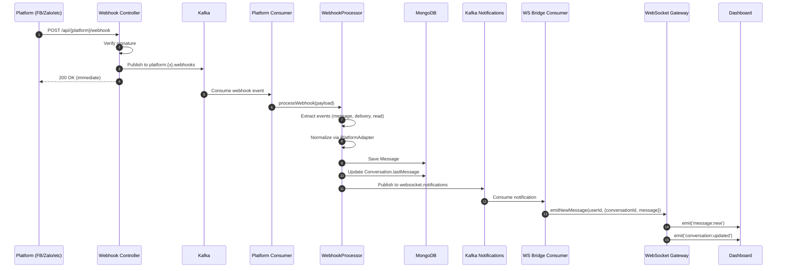
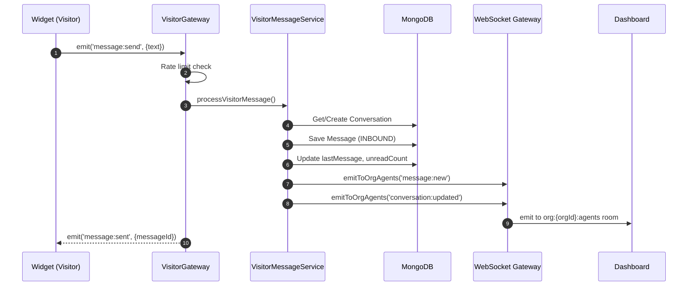
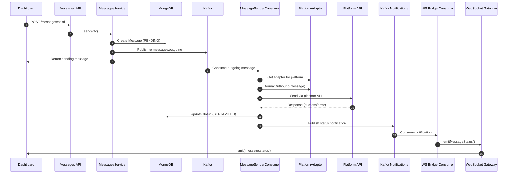
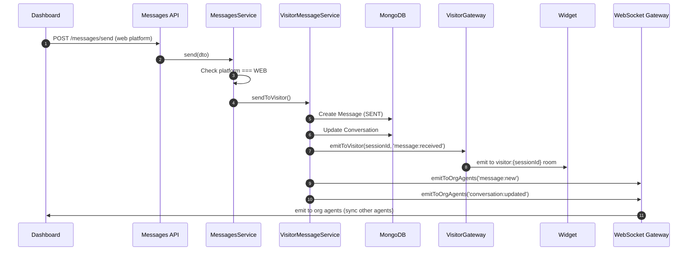
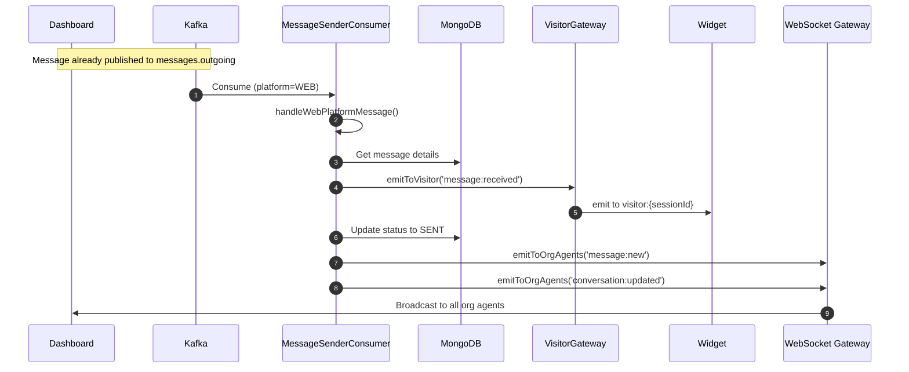
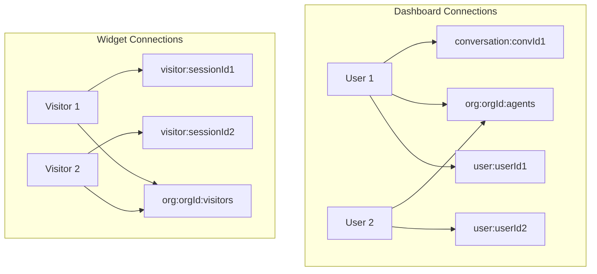
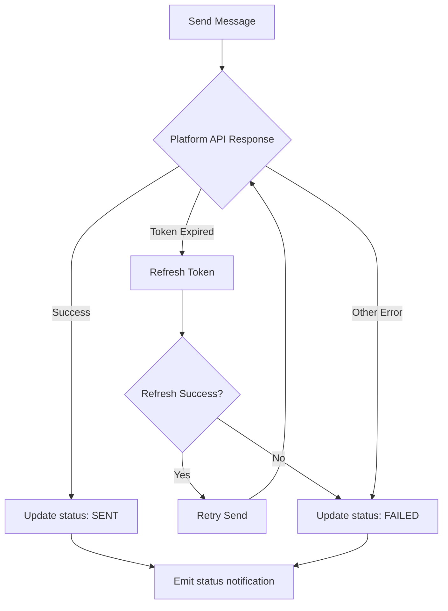
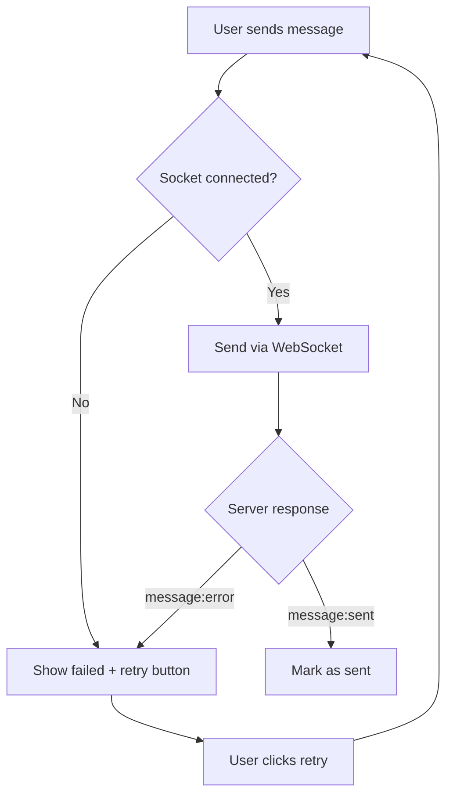

# Message Flow Architecture

Tài liệu mô tả chi tiết luồng gửi/nhận tin nhắn trong hệ thống MiAgent.

## Overview

Hệ thống sử dụng Kafka làm message broker để xử lý async và WebSocket để real-time notification.

## Kafka Topics

| Topic | Partition Key | Purpose |
|-------|---------------|---------|
| `platform.facebook.webhooks` | `facebook:{pageId}` | Facebook webhooks |
| `platform.zalo.webhooks` | `zalo:{oaId}` | Zalo webhooks |
| `platform.tiktok.webhooks` | `tiktok:{shopId}` | TikTok webhooks |
| `platform.shopee.webhooks` | `shopee:{shopId}` | Shopee webhooks |
| `messages.outgoing` | `conversationId` | Outbound messages |
| `websocket.notifications` | `userId` | Real-time notifications |

---

## Inbound Message Flow (Platform → Dashboard)

Luồng tin nhắn từ các platform (Facebook, Zalo, TikTok, Shopee) đến Dashboard.

### Flow Description

1. **Webhook Reception**: Platform gửi webhook đến HTTP endpoint
2. **Signature Verification**: Verify HMAC signature để đảm bảo authenticity
3. **Kafka Publish**: Publish raw payload đến Kafka, return 200 ngay lập tức
4. **Async Processing**: Consumer xử lý webhook từ Kafka
5. **Normalization**: PlatformAdapter normalize message sang format thống nhất
6. **Database Save**: Lưu Message và update Conversation
7. **Notification**: Publish đến websocket.notifications topic
8. **WebSocket Bridge**: Bridge consumer emit đến WebSocket Gateway
9. **Real-time Update**: Dashboard nhận event qua WebSocket

---

## Inbound Message Flow (Widget → Dashboard)

Luồng tin nhắn từ Widget (web chat) đến Dashboard.

### Flow Description

1. **Widget Send**: Visitor emit message qua WebSocket
2. **Rate Limit**: Check spam protection
3. **Process**: VisitorMessageService xử lý message
4. **Database**: Lưu message và update conversation
5. **Broadcast**: Emit đến tất cả agents trong org
6. **Confirmation**: Gửi confirmation về widget

---

## Outbound Message Flow (Dashboard → Platform)

Luồng tin nhắn từ Dashboard đến các platform.

### Flow Description

1. **API Call**: Dashboard gửi request tạo message
2. **Create Pending**: Tạo message với status PENDING
3. **Kafka Publish**: Publish đến messages.outgoing topic
4. **Optimistic Return**: Return message ngay cho UI
5. **Async Send**: Consumer gửi message qua platform API
6. **Status Update**: Update status sau khi gửi
7. **Notification**: Emit status change đến Dashboard

---

## Outbound Message Flow (Dashboard → Widget)

Luồng tin nhắn từ Dashboard (Agent) đến Widget (Visitor).

### Alternative Path (via Kafka):

---

## WebSocket Rooms Structure

### Room Types

| Room Pattern | Purpose | Namespace |
|--------------|---------|-----------|
| `user:{userId}` | User-specific notifications | default (/) |
| `org:{orgId}:agents` | Broadcast to all org agents | default (/) |
| `conversation:{convId}` | Conversation-specific events | default (/) |
| `visitor:{sessionId}` | Visitor-specific messages | /visitor |
| `org:{orgId}:visitors` | Broadcast to all org visitors | /visitor |

---

## Event Types

### Dashboard Events (default namespace)

| Event | Direction | Payload | Description |
|-------|-----------|---------|-------------|
| `message:new` | Server→Client | `{conversationId, message}` | New message received |
| `message:status` | Server→Client | `{conversationId, messageId, status}` | Message status change |
| `conversation:updated` | Server→Client | `{conversationId, ...}` | Conversation updated |
| `typing:indicator` | Bidirectional | `{conversationId, isTyping}` | Typing status |

### Widget Events (/visitor namespace)

| Event | Direction | Payload | Description |
|-------|-----------|---------|-------------|
| `message:send` | Client→Server | `{text, mediaUrl?}` | Visitor sends message |
| `message:sent` | Server→Client | `{messageId, conversationId}` | Send confirmation |
| `message:received` | Server→Client | `{message}` | Agent reply received |
| `message:error` | Server→Client | `{error}` | Send failed |
| `conversation:restored` | Server→Client | `{messages[]}` | Chat history restored |

---

## Error Handling

### Message Send Failures

### Widget Retry Flow

---

## Files Reference

| Component | File Path |
|-----------|-----------|
| WebSocket Gateway | `backend/src/modules/websocket/websocket.gateway.ts` |
| Visitor Gateway | `backend/src/modules/websocket/visitor.gateway.ts` |
| WS Bridge Consumer | `backend/src/modules/websocket/websocket-bridge.consumer.ts` |
| Visitor Message Service | `backend/src/modules/websocket/visitor-message.service.ts` |
| Message Sender Consumer | `backend/src/infra/kafka/consumers/message-sender.consumer.ts` |
| Messages Service | `backend/src/modules/messages/messages.service.ts` |
| Webhook Processor | `backend/src/modules/platforms/core/services/webhook-processor.service.ts` |
| Platform Adapters | `backend/src/modules/platforms/adapters/*.adapter.ts` |
| Widget Socket | `frontend/widget/src/socket.ts` |
| Frontend WS Events | `frontend/lib/websocket/useConversationWebSocketEvents.ts` |
